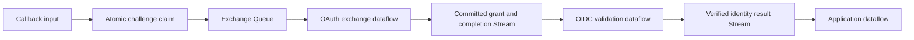

# Protocol dataflow and state model implementation plan

Status: **Implementation authorized; target-language source authored — 2026-11-19.**
All eight packages now expose command dataflows, result Streams, and explicit state
resources. OAuth/OIDC continuation, optional HTTP bindings, native maintenance,
SCIM query/write ports, consumers, and recovery tests are authored. The pinned
compiler still refuses entries before checking protocol bodies; no executable
qualification is claimed. The [API/state map](refactor-compatibility.md) records
the source changes and the migration gate that still needs a real prior artifact.
The [initial implementation plan](implementation-plan.md) remains the record of
workspace setup and first profiles; this plan supersedes its implementation
approach and delivery sequence for the refactor. Package boundaries, selective
consumption, protocol exclusions, and qualification obligations remain in scope.

## Objective

Make each package a composable Transit program whose inputs, state transitions,
effects, and outputs can be followed through native declarations. Applications
should connect protocol inputs and consume results without implementing a poller
or calling a finishing method to advance an already accepted operation.

Use dataflows for behavior, functions for bounded transformations, guards for
named conditions, and small procedures for mutations that must compose inside a
caller's transaction. Choose Tables, versioned Documents, KV, Queues, and Streams
according to their semantics. A smaller procedure count alone is not acceptance.

The source continues to target the intended language. Unsupported constructs are
compiler/runtime requirements, not reasons to add a package scheduler, custom
storage engine, resolver, or protocol implementation in another language.

## Starting point and language basis

Before this refactor, the package implementation sources declared 20 procedures and two
dataflows, with no Sources, Streams, Views, Publications, or named Guards. The
original responsibilities were concentrated in these files (links now show the refactor):

- [OAuth client](../packages/oauth/src/client.transit) exposes command-like
  procedures and outcome lookups; [exchange](../packages/oauth/src/exchange.transit)
  switches between code exchange, refresh, and revocation in one flow.
- [OIDC relying party](../packages/oidc/src/relying-party.transit) requires the
  consumer to call `finish` after the OAuth exchange.
- [SAML](../packages/saml/src/service-provider.transit) and
  [WebAuthn](../packages/webauthn/src/relying-party.transit) expose entire ceremony
  steps as procedures.
- [SCIM](../packages/scim/src/service-provider.transit) dispatches HTTP and
  performs reads and writes through one procedure; its
  [DocumentStore](../packages/scim/src/store.transit) was a JSON Table
  with list materialization and procedural relationship maintenance.

The [language proposal](target-language.md) describes the current authored
source, and the [requirement ledger](compiler-requirements.md) records actual
compiler refusals. Those refusals occur before protocol bodies are checked.

Resource semantics were reviewed in the upstream checkout at
`8bbe56e13a839e4485cfa67593f1425ee1594954`, particularly
[Document SQL](https://github.com/spoke-sh/transit/blob/8bbe56e13a839e4485cfa67593f1425ee1594954/docs/handbook/reference/sql/create-document.md),
[KV SQL](https://github.com/spoke-sh/transit/blob/8bbe56e13a839e4485cfa67593f1425ee1594954/docs/handbook/reference/sql/create-kv.md),
[Streams](https://github.com/spoke-sh/transit/blob/8bbe56e13a839e4485cfa67593f1425ee1594954/contracts/STREAM_V1.md),
and [application composition](https://github.com/spoke-sh/transit/blob/8bbe56e13a839e4485cfa67593f1425ee1594954/docs/roadmap/12-application-modules-compilation-and-testing.md).
This review does not update the repository pins or establish that the compiler
can compose those resource owners. Direct SQL, native storage, and compiled
package support must be qualified separately. All new interfaces below are
design requirements; exact proposed syntax belongs in `target-language.md` when
the corresponding source is authored.

## Shared decisions

### Public composition

1. Keep the eight roots under `packages/` and their existing dependency graph.
   Consumers select public modules and targets from one exact repository revision.
2. Expose typed commands/dataflows, result Streams, and authorized read Views as
   the primary stateful API. Typed outcomes distinguish success, refusal, pending
   work, and unknown external effects. Reading an outcome never advances work.
3. Supply optional HTTP binding modules and Publications in the same package.
   Applications may instead connect their own Sources and dataflows. Selecting a
   core must not pull in HTTP routes, publication settings, or another protocol.
4. Keep pure validators independently selectable. Retain small public atomic
   procedures only where consumers need a shared transaction, with the same
   guards and mutation semantics as the command path. Avoid two implementations.
5. Separate construction, authorization, and activation. Explicit application
   composition binds instance identity, policy, secrets, invocation rights,
   effect rights, read rights, and optional transports. Imports grant no rights.
6. Preserve the accepted caller and operation through queues and downstream
   consumers. A result reference is not authority to read a credential. Background
   executor identity must not replace the original owner.
7. Applications own sessions, account linking, and business policy; integrations
   own product APIs. Protocol results provide the minimum claims and protected
   references needed for those consumers.

### Choosing state resources

| Construct | Use in these packages | Required boundary |
| --- | --- | --- |
| Versioned Document | Mutable protocol configuration, approved trust material, discovery/JWKS snapshots, and structured SCIM attributes. | Explicit revision and guarded reads/writes. Immutable provider constants remain constructor data. Security decisions refuse stale or unresolved state; no automatic merge or CRDT conflict resolution. |
| KV | Point-addressed challenges, ceremony contexts, and assertion replay claims. | Typed values, commitment-based keys where appropriate, conditional insertion and revision comparison, and atomic composition with other resources. A key lookup or handle never grants authority. |
| Table | Searchable credential records, operation status, identifiers, uniqueness claims, and memberships. | Native unique/FK/check constraints and transactional predicates. Relationships and integrity must not depend on eventual projections. |
| Queue | Accepted work that needs a durable continuation, especially external effects. | Native leases/checkpoints, original operation identity, bounded execution, explicit refusal/unknown handling, and atomic settlement. One-transaction commands need no extra queue. |
| Stream | Committed protocol outcomes, resource changes, and bounded diagnostic receipts. | Typed immutable events, stable event identity, authorized consumers, explicit ordering and retention. Required workflow progress uses durable consumer checkpoints; no secret payloads. |
| View / Publication | Current authorized status, credential metadata, SCIM resources, and optional external read surfaces. | Declarative queries over canonical state. Authority is checked at disclosure; a cached projection cannot authorize a mutation. |

Document values are structured and typed; using a Document does not imply
schemaless JSON. Protocol extension fields remain bounded and validated. No
package needs collaborative CRDT semantics in this revision.

Each field has one authoritative owner. A view can derive it, and a constrained
index may enforce it, but a second independently writable copy is forbidden.
Raw tokens, codes, assertions, and browser responses do not belong in ordinary
Documents, KV values, Streams, or dead-letter payloads. Retain protected native
references only where recovery requires them, with purpose, owner, and lifetime
enforcement. A protected reference exposed to one module is not a public event.

### Transactions, recovery, and retention

- A command either completes atomically or commits its state change, queued
  continuation, and outcome event in one native decision. No dual write or custom
  outbox worker bridges those resources. Missing cross-resource support is an
  explicit upstream blocker.
- Effect dataflows expose dispatch, original effect identity, observations,
  acceptance, and failure handling directly. Unknown results remain inspectable;
  recovery observes the original effect rather than sending it under a new ID.
- A required Stream consumer commits its input checkpoint with the resulting
  state changes and emitted events. Replays cannot consume a challenge twice or
  produce another identity result. Ordering is per declared key/partition, not
  assumed global. Correlation, event IDs, and generations reject stale events.
- Core work Streams and optional diagnostic Streams have separate policies.
  Retention must protect required consumer progress and accepted work. Optional
  observers that fall behind receive an explicit gap and resnapshot contract;
  resnapshotting never replays external effects or reconstructs lost authority.
- Logical expiry is checked at acceptance and disclosure using authoritative
  time. Physical deletion is separate. Replay claims remain at least through the
  last permitted acceptance time, including skew. Unresolved effects and retained
  native receipts survive ordinary challenge or diagnostic retention limits.
- Cleanup uses bounded native maintenance or a native maintenance dataflow. It
  must not depend on an application remembering to call `prune`. Cleanup may
  destroy expired protected material while retaining the metadata needed to
  prove an operation terminal or unresolved; loss never permits redispatch.
  Where KV has no native expiry traversal, maintain a constrained Table index of
  key and deadline in the same transaction as the KV mutation. Cleanup queries
  that index in bounded pages and rechecks canonical KV state before deletion;
  the index neither duplicates the challenge payload nor decides validity.
- HTTP bindings preserve strict decoding, duplicate-field refusal, protected
  inputs, and linear response ownership. Any handoff commits with admission.
  A lost response does not repeat an accepted command. Original-request replay
  is distinct from a new request reusing a consumed protocol challenge.

## Changes by package

### OAuth core

Split the client into declarations for state, guards, commands, effects, read
interfaces, and optional HTTP bindings. Replace the `job.kind` dispatcher with
named authorization-code exchange, refresh, and revocation flows. Reuse pure
request/response helpers and small atomic mutations without hiding dispatch.

| Concern | Proposed model |
| --- | --- |
| Provider behavior | Immutable typed provider module: endpoints, encoding, capabilities, and bounded normalization. |
| Mutable client policy | Versioned Document or an application-supplied guarded Document interface; secret references only. Record the accepted policy revision and recheck it at effect and result boundaries. |
| Authorization challenge | Private KV keyed by state commitment, with browser binding, PKCE handle, owner, expiry, policy/secret revisions, and claim state. Derive an opaque correlation ID without duplicating the challenge in another table. |
| Credentials | Private Table with owner, generation, status, scope/expiry metadata, and protected token references. |
| Operations | Current protocol status Table referencing native effect identity; it does not reimplement the native dispatch/retry ledger. |
| Work and results | Explicit exchange/refresh/revocation Queue inputs and typed completion Stream; authorized status and credential metadata Views. Diagnostic receipts are separate and optional. |

`begin_authorization` completes in one atomic command and returns redirect data.
`accept_callback` validates and claims the challenge, then commits the exchange
intent. Provider denial commits a refusal without dispatch. Exchange accepts
credentials and emits its completion in one transaction. Refresh fences the old
generation before dispatch and publishes the new generation atomically; revocation
denies local use immediately while retaining its remote outcome separately.

Consumers can observe credential metadata or compose an authorized protected-use
interface. There is no ordinary token-bearing publication. Completion events
carry correlation and credential references, never access or refresh tokens.

Acceptance: complete authorization, refresh, and revocation through installed
flows; concurrent callbacks/generation changes have one accepted transition;
policy changes fence stale work; crash/replay and lost replies cannot cause a
second token dispatch or overwrite terminal success.

### OAuth provider adapters

Each adapter re-exports the core command, result, read, and optional binding
interfaces, specialized through its provider module. Remove method forwarding
that leaves the old procedure API as the primary interface. Adapters create no
additional workflow, challenge store, or grant state machine.

| Package | Adapter review and acceptance |
| --- | --- |
| `oauth-github` | Preserve GitHub endpoint/authentication and scope normalization rules. Exercise core flows with provider fixtures; no repository/profile product API expansion. |
| `oauth-google` | Preserve consent/offline-access parameters and refresh/revocation behavior, including an omitted refresh token. OAuth completion is authorization; OIDC remains the identity layer. |
| `oauth-facebook` | Preserve explicit API version, request encoding, response normalization, and capability exclusions. Audit the documented PKCE/profile assumptions before live qualification; do not infer support from shared-core tests. |

Run one shared flow contract suite through all three public adapters, plus their
provider-specific cases. Refresh official provider references during those
implementation slices without silently broadening the supported profiles.

### OIDC relying party

Compose OAuth's completion Stream with a native validation dataflow. Remove the
consumer-driven `finish` step. The accepted authorization context determines the
expected issuer, audience, nonce, authentication age, and owner throughout the
continuation. Discovery readiness and failures remain explicit outcomes.

- Store validated discovery and JWKS snapshots as versioned Documents with
  issuer, trusted endpoint binding, content/revision attribution, and freshness.
  Keep old accepted revision references only as required by recovery policy.
- Use private KV for nonce/authorization context, keyed by the OAuth correlation
  ID. Creating it and beginning OAuth must share a transaction, using a small
  atomic core helper where needed.
- Discovery and key refresh use dedicated bounded effect flows. An unknown key
  may request at most one refresh for the accepted validation attempt; duplicate
  events cannot create a fetch loop. Freshness, trust changes, and refresh
  failures produce defined refusals or unresolved status.
- Consume a successful OAuth result, retrieve token material through an
  authorized protected interface, validate claims with pure helpers, and commit
  context consumption, verified result, output event, and consumer checkpoint
  together. Propagate OAuth refusal/unknown outcomes without accepting identity.
- Export typed identity results for application dataflows and an authorized
  current-status View. Claims disclosure follows current policy. Applications
  can consume these results without receiving the protected ID token.

The intended composition is:

Acceptance: a consumer obtains a verified identity after supplying protocol
inputs, without polling to advance work. Test failure propagation, stale or
rotated keys, duplicate completions, restart between OAuth and OIDC acceptance,
expired protected material, and two isolated relying-party instances.

### SAML service provider

- Use a versioned Document for approved metadata/trust policy, with explicit
  issuer, endpoint, key, and revision binding. Metadata parsing remains a pure
  bounded operation; ingestion alone cannot approve new trust.
- Store outstanding request/RelayState context in KV. Store replay claims in a
  separate KV keyed by issuer plus assertion identity, with conditional insertion
  and a lifetime covering assertion validity and allowed clock skew.
- Expose `begin_sso` and `accept_assertion` command/dataflows. Preserve the browser
  redirect/POST round trip as two external inputs. The current local verification
  profile needs no background exchange queue.
- Assertion acceptance commits replay insertion, request consumption, a typed
  identity result, and its result event together. Named guards expose browser,
  request, destination, issuer, audience, time, and current-trust conditions.
- Keep XML construction, decoding, and exact signed-node verification in focused
  functions. Add optional Redirect/POST bindings and authorized result reads.

Acceptance: replay and concurrent submissions cannot produce two identities;
trust changes fence stale assertions; cleanup cannot reopen the acceptance
window; existing XML wrapping/entity and protocol-validation cases remain.

### WebAuthn relying party

- Keep credential IDs, account handles, public keys, counters, and backup state
  in a constrained Table. Account lookup and credential uniqueness are relational.
- Use KV for registration/authentication challenges, browser binding, ceremony,
  intended account, and expiry. Use a versioned Document interface for mutable
  relying-party policy; immutable installation settings stay constructor values.
- Expose separate begin/accept commands for registration and authentication.
  Browser authenticator responses remain external inputs; no queue is needed
  just to split local validation steps.
- Express ownership, challenge, origin/RP ID, and policy conditions as guards.
  Keep client-data parsing, CBOR/COSE decoding, and signature checks in bounded
  functions. Acceptance atomically consumes the challenge, inserts/updates the
  credential, and emits the result, including any permitted counter warning.
- Publish safe credential metadata and typed ceremony outcomes through explicit
  read interfaces. Account enumeration and result disclosure require authority.
  Optional HTTP modules bind these commands without creating sessions.

Acceptance: registration uniqueness, concurrent counter updates, ceremony mix-up,
replay, policy changes, and challenge cleanup are tested through command flows;
the existing attestation/algorithm profile and negative verification cases remain.

### SCIM service provider

Replace the catch-all `request` procedure with explicit HTTP bindings, per-operation
commands, and declarative reads. Preserve SCIM media types, statuses, errors,
conditional requests, and atomic PATCH behavior when changing the execution model.

- Redesign `Store` around a typed query surface and small atomic write helpers.
  Applications can supply their existing identity storage. Avoid a `list()` API
  that materializes the collection before filtering or pagination.
- In the optional default store, use Tables for resource identifiers, normalized
  username uniqueness, and membership relationships. Versioned Documents own
  remaining structured attributes and supported extensions. Assign disjoint
  writable fields: wire resource Views combine them, rather than storing a second
  mutable copy of usernames or membership arrays inside Documents.
- A single resource revision/ETag covers the full visible resource, including
  related membership changes. Commit document/table mutations, revision updates,
  and change events together. Use expected-version conflict refusal, not automatic
  document merging. Deleting a User updates affected Group membership and versions
  in the same transaction; native constraints enforce reference integrity.
- Pure functions parse bounded filter/PATCH syntax and validate values. Lower
  filters to typed predicates over the Store query surface, preserving SCIM case,
  null, and multivalue semantics. Use native selection, ordering, counts, and
  pagination over one read snapshot; no dynamically concatenated SQL.
- Discovery and resource reads use Views plus an optional SCIM response binding;
  a generic publication envelope alone does not satisfy SCIM's wire contract.
  Create/replace/patch/delete are atomic command/dataflows with named policy and
  version guards. Local provisioning requires no artificial queue lifecycle.
- Emit typed resource-change events with IDs, revision, operation, and safe change
  metadata. Consumers retrieve permitted attributes through current read policy;
  events do not broadcast full identity documents or grant application access.

Acceptance: filter/page/count consistency, unique-name races, stale ETags,
multi-operation PATCH rollback, membership integrity, and event/checkpoint recovery
all hold. Exercise both the default store and an application-supplied store.
Keep declared collection/work budgets explicit; this refactor alone makes no
unbounded scalability or broader SCIM conformance claim.

## Source organization and consumer examples

Keep the established `build.transit`, `src/`, `tests/`, and `examples/` boundaries.
Within `src/`, use `types.transit`, `state.transit`, `guards.transit`, operation
files such as `authorization.transit` or `provisioning.transit`, `effects.transit`,
`reads.transit`, and optional `http.transit` where those concerns exist. These are
suggested responsibilities, not mandatory empty files. Thin provider adapters
remain small. Pure verification/codec files stay separate and independently usable.

Public build entries select core, pure helpers, and optional transport modules
without instantiating unselected resources. Application examples must wire real
commands, result consumers, explicit grants, and activation, rather than merely
constructing a module. Include one example of atomic procedure composition where
that boundary is needed, and show that it shares the command's guards.

Expand independently rooted consumer fixtures to cover:

- Each OAuth provider alone; generic OIDC plus OAuth; OIDC plus GitHub with
  isolated instances; standalone SAML, SCIM, and WebAuthn; SAML plus SCIM linked
  by explicit application policy, without implicit account provisioning.
- Core-only composition with no HTTP Source or Publication dependencies; optional
  HTTP composition with application-selected routes; pure validator selection
  with no storage, activation, or unrelated crypto/codec dependencies.
- Two instances, conflicting bindings, cross-owner access refusal, event consumer
  isolation, and an application consuming completion without a progress poller.
- Existing pinned external, frozen offline, mixed-revision, unrelated-source, and
  production-versus-test selection gates from the initial plan.

## Compiler/runtime requirements and evidence

Extend the existing ledger rather than claiming new syntax works. Keep TP-01/02
for selection and dependency resolution; expand TP-03/04 for typed resource ports,
guards and transactional helpers, TP-05 for protected references, TP-06 for command,
Queue/Stream, effect and response composition, TP-08 for deterministic testing,
and TP-09 for SQL/provenance/evolution. Add focused resource requirements for:

| Proposed requirement | Minimal acceptance probe |
| --- | --- |
| Versioned Documents | Guard an exact accepted policy revision; reject a concurrent policy edit at commit/dispatch. Qualify the selected row/tree owner explicitly; direct row support does not prove arbitrary tree mutation support. |
| Typed KV | Point read, absent insertion, revision-conditional claim, expiry checks, and two contenders with one winner. KV scans or TTL behavior are not assumed. |
| Mixed transactions | Atomically mutate selected Table/Document/KV owners with Queue enqueue or Stream append/checkpoint. Inject failure at each participant; no partial acceptance. |
| Stream composition | Typed exports, authorized consumer groups, stable event identity, fenced checkpoints, bounded catch-up, duplicate delivery, and retention-gap behavior. |
| Declarative reads and constraints | Parameterized relational module exports, SCIM predicate semantics, uniqueness/FKs, consistent page/count reads, and current-policy publication. |
| Native lifecycle | Bounded cleanup, retained unresolved work, protected-value destruction, and explicit replacement/migration bases. |

Each requirement needs a small `.transit` probe, exact reviewed toolchain identity,
first refusal or execution evidence, intended recovery/authorization semantics,
and the affected package test. Audit existing upstream support before labeling a
capability missing. Do not widen parser exceptions to cover runtime failures.
Keep observed support, authored contracts, and qualification status distinct.

## Delivery sequence

Each row is a reviewable source change; compilation can remain blocked with
specific evidence. The review gates apply to the authored design first and become
required executed checks as native support arrives.

| Step | Deliverable | Review gate |
| --- | --- | --- |
| 1. Shared contracts | Update target-language proposal, resource/authority interfaces, event schema and retention rules, API mapping, and focused compiler probes. | Every resource has one owner; each transition names its trigger, transaction, output, failure path, and required native capabilities. |
| 2. OAuth/OIDC vertical slice | Refactor OAuth, adapt GitHub for the first provider consumer, and connect generic OIDC completion/validation. Rewrite representative consumer and recovery tests. | Callback to verified result is driven by installed flows; no consumer `finish` loop, duplicate dispatch, or token-bearing ordinary event. Review this API before propagating it. |
| 3. All OAuth adapters | Complete GitHub coverage and convert Google/Facebook, examples, and shared contract suite. | All three expose the same core composition with explicit capability differences and no duplicated orchestration. |
| 4. SAML | Versioned trust, challenge/replay KV, command flows, results, optional bindings, and preserved validation tests. | One atomic assertion acceptance; trust/expiry/replay races have explicit outcomes. |
| 5. WebAuthn | Challenge KV, credential constraints, policy guards, ceremony commands/results, and optional bindings. | One accepted ceremony transition; credential/counter updates and emitted result cannot diverge. |
| 6. SCIM | Relational Store interface, versioned attributes, operation commands, query-backed reads, HTTP bindings, and change Streams. | Preserve wire semantics and PATCH/ETag atomicity; exercise both store implementations and relationship races. |
| 7. Integration and qualification | Complete consumer matrix, migration designs, per-package documentation, native probes, and executable checks as available. | All eight have source-complete flows and acceptance tests; supported cases execute; blocked cases retain precise evidence and remain unqualified. |

Steps 4–6 are independent once shared contracts settle. Every slice updates its
package README, public exports, examples, tests, and requirement references in the
same change. Keep the existing five Just tasks and upstream artifact-only Nix
shell. Pin upgrades are separate reviewed changes; no Zig toolchain is introduced.

## State evolution and compatibility

This changes public APIs and resource kinds. Document the old-to-new command and
result mapping; update all in-repository consumers together. No production package
has shipped, so do not maintain a second legacy workflow by default. A temporary
compatibility helper, if needed by an identified consumer, must reuse the same
transition and cannot become a poller.

Table-to-KV/Document conversion is a state migration, not a rename. Preserve
instance bindings, credential IDs/generations, challenge commitments, protected
handle ownership, accepted operation identities, and required replay evidence.
Never copy a pending operation into a fresh queue as new work. Plan replacement
against an explicit prior definition: either prove in-flight work can resume
under its original definition or refuse cutover while it remains unresolved.

Once both definitions are executable, qualify a synthetic old-state upgrade with
consumed challenges, pending and unknown effects, credentials, and Stream consumer
positions. Preserve that real prior artifact as the migration basis. Until then,
record the migration contract and unexecuted gate; do not fabricate old SQL or
delete retained state to make a fresh installation pass.

## Validation and completion

For every package, retain existing protocol-positive and negative cases and add
command/Source input, current state, event output, and consumer-progress assertions.
Mock only native external effects; do not replace the package dataflows with test
handlers. Separate core tests from optional HTTP binding tests.

Required cross-cutting cases are concurrent claims, stale policy/secret/trust
revisions, lost accepted replies, duplicate events, restart at commit/effect/
checkpoint boundaries, changed authority at disclosure, expired protected inputs,
bounded backpressure, lagging consumers, and cleanup while work is unresolved.
Assert external dispatch counts and terminal-result stability as well as values.

Source completion means all eight packages expose the revised public composition,
their consumers demonstrate automatic continuation where needed, every storage
choice and retention rule is explicit, and tests specify the supported profiles.
There must be no abandoned procedural engine behind a new dataflow wrapper.

Executable qualification additionally requires real native builds/tests, emitted
SQL installation, isolated instances, selected dependency closure, offline builds,
and actual state-evolution evidence on named toolchain revisions. Bootstrap checks
and matched compiler gaps do not satisfy these gates. No provider live-support
claim follows from mocked protocol tests.
